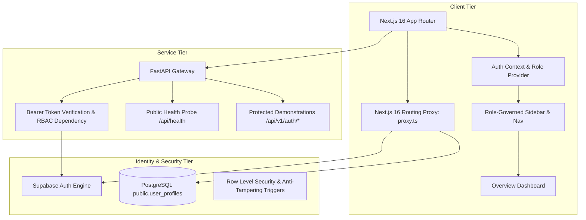
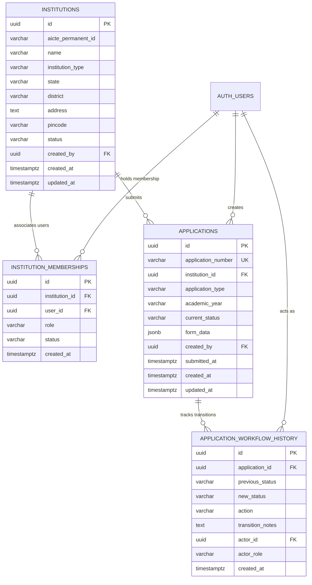
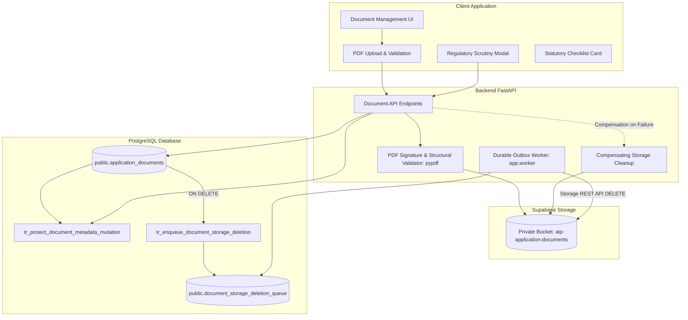

# System Architecture — AICTE Approval Intelligence Platform (AIP)

## 1. Executive Summary

The **AICTE Approval Intelligence Platform (AIP)** is an enterprise regulatory intelligence and workflow system built for Smart India Hackathon Problem Statement 26262: *Integrated AICTE Approval Workflow Automation, Compliance Monitoring, and Alert Management System*.

The platform addresses two fundamental operational bottlenecks in institutional approval processes:
1. **AI-Powered Document Intelligence:** Automated information extraction from complex institutional filings, discrepancy detection, deficiency flagging, and bidirectional evidence linking for human-in-the-loop auditability.
2. **Explainable Bottleneck Detection:** Transparent queue analytics, institutional delay attribution, processing variance breakdown, and predictive workload forecasting.



---

## 2. Monorepo Repository Structure

The project employs a structured monorepo separating administrative web clients, high-performance Python services, database migrations, and architectural documentation:

```
AICTE-Approval-Intelligence/
├── frontend/                     # Next.js 16 App Router (TypeScript, Tailwind, Lucide)
│   ├── src/
│   │   ├── proxy.ts              # Next.js 16 Routing Proxy for session & route governance
│   │   ├── app/                  # App Router pages and route handlers
│   │   │   ├── layout.tsx        # Root layout with AuthProvider & AppShell
│   │   │   ├── page.tsx          # Overview dashboard
│   │   │   ├── login/page.tsx    # Sovereign sign-in portal
│   │   │   ├── register/page.tsx # Applicant representative registration
│   │   │   ├── confirm-email/    # Email verification pending screen
│   │   │   ├── forgot-password/  # Password reset request
│   │   │   ├── reset-password/   # Password reset completion
│   │   │   ├── access-denied/    # 403 Regulatory Access Denied screen
│   │   │   ├── auth/callback/    # PKCE authorization code exchange handler
│   │   │   ├── applications/     # Applications directory placeholder
│   │   │   ├── documents/        # Document Intelligence placeholder
│   │   │   ├── bottlenecks/      # Bottleneck Analytics placeholder
│   │   │   ├── compliance/       # Compliance management placeholder
│   │   │   ├── alerts/           # Alert management placeholder
│   │   │   ├── reports/          # Audit & reporting placeholder
│   │   │   └── admin/            # Platform administration placeholder
│   │   ├── components/
│   │   │   ├── layout/           # AppShell, Sidebar, TopNavbar
│   │   │   ├── dashboard/        # SummaryCards, Charts, ActivityTable
│   │   │   └── ui/               # Reusable UI primitives & PlaceholderPage
│   │   ├── lib/
│   │   │   ├── auth/             # AuthContext, roles policy, permissions matrix
│   │   │   ├── supabase/         # SSR client, server client, proxy session helper
│   │   │   ├── mock-data.ts      # Unified demo data source of truth
│   │   │   └── utils.ts          # Tailwind merge & formatting utilities
│   │   └── types/                # Strict TypeScript domain interfaces
│   ├── package.json              # Client dependencies and npm scripts
│   └── .env.example              # Client environment configuration
│
├── backend/                      # Python 3.13 FastAPI Service
│   ├── app/
│   │   ├── main.py               # Application factory & CORS initialization
│   │   ├── core/
│   │   │   ├── config.py         # Pydantic BaseSettings with Supabase config
│   │   │   └── security.py       # Cryptographic bearer token verification & RBAC
│   │   ├── api/
│   │   │   └── v1/
│   │   │       ├── api.py        # Router aggregation
│   │   │       └── endpoints/
│   │   │           ├── health.py # Public vitality & health endpoint
│   │   │           └── auth.py   # Protected caller inspection & RBAC demos
│   │   └── schemas/
│   │       ├── health.py         # HealthResponse Pydantic models
│   │       └── auth.py           # UserAuthPayload & protected schemas
│   ├── tests/
│   │   └── test_auth_rbac.py     # Automated pytest suite for security & RBAC
│   ├── pyproject.toml            # uv project specification and dependencies
│   ├── uv.lock                   # Deterministic lockfile
│   └── .env.example              # Backend environment variables
│
├── supabase/                     # Database Migrations & Security Schemas
│   └── migrations/
│       └── 20261022000001_auth_roles_schema.sql # RLS & role anti-elevation triggers
│
├── docs/                         # System specifications & roadmap
│   ├── ARCHITECTURE.md           # Architecture specifications (this document)
│   ├── DEVELOPMENT.md            # Local setup & developer workflow
│   └── MODULE_ROADMAP.md         # Phased 7-phase / 14-module delivery breakdown
├── .editorconfig                 # Multi-language formatting standards
├── .gitignore                    # Secrets, caches, and build artifact exclusions
└── README.md                     # Monorepo overview and startup instructions
```

---

## 3. Role-Based Access Control (RBAC) Architecture

Module 2 introduces five standardized regulatory personas matching the AICTE Approval Process Handbook (APH):

| Persona / Role | Description | Accessible Routes | Security Boundary |
| :--- | :--- | :--- | :--- |
| `applicant_institution_representative` | Technical college director / registrar filing for EoA or intake expansion. | `/`, `/applications`, `/documents`, `/alerts` | Default role for all public self-registrations. |
| `regional_scrutiny_officer` | AICTE regional official verifying compliance, inspecting affidavits, and managing backlogs. | `/`, `/applications`, `/documents`, `/bottlenecks`, `/compliance`, `/alerts`, `/reports` | Assigned via administrative delegation. |
| `evc_evaluator` | Academic/industry expert inspecting physical campus infrastructure. | `/`, `/applications`, `/documents` | Restricted to assigned evaluations. |
| `shc_member` | Senior jurist/academic presiding over institutional dispute appeals. | `/`, `/applications`, `/documents` | Restricted to assigned hearing cases. |
| `aicte_executive_admin` | Central AICTE authority issuing final approvals, setting quotas, and handbook rules. | **All Routes** (including `/admin`) | Strict administrative authority. |

### Database Integrity & Anti-Tampering Triggers
- **Immutable Default on Signup**: The PostgreSQL trigger `handle_new_auth_user()` ensures that any public registration through Supabase Auth automatically creates a profile with `role = 'applicant_institution_representative'`, ignoring any client-submitted role fields.
- **Elevation Protection**: The PostgreSQL trigger `protect_user_role_elevation()` rejects any SQL `UPDATE` that modifies `role` unless executed with `service_role` credentials or by an `aicte_executive_admin`.

---

## 4. Next.js 16 Routing Proxy (`src/proxy.ts`)

Next.js 16 introduces `src/proxy.ts` as the standard routing proxy replacing legacy `middleware.ts`. In AIP, `proxy.ts`:
1. Executes `@supabase/ssr` session cookie synchronization on incoming requests.
2. Calls `supabase.auth.getUser()` to cryptographically verify token freshness (rejecting unverified cookie tampering).
3. Evaluates requested routes against `ROUTE_PERMISSIONS`:
   - Unauthenticated callers are redirected to `/login?redirectTo=<path>`.
   - Authenticated callers lacking role clearance are redirected to `/access-denied?path=<path>&role=<role>`.

---

## 5. FastAPI Security & Cryptographic Token Verification

All protected backend endpoints enforce token verification:
- **Bearer Token Extraction**: Uses FastAPI `HTTPBearer`.
- **Dual Verification Modes**:
  1. *Local HMAC Secret*: When `SUPABASE_JWT_SECRET` is configured, verifies signatures locally using `pyjwt` with `HS256`, checking expiration (`exp`) and audience (`aud="authenticated"`).
  2. *Supabase Auth API Verification*: When URL and Anon Key are configured, queries `{SUPABASE_URL}/auth/v1/user` asynchronously using `httpx`.
- **Role Enforcement Dependency (`require_roles`)**: A reusable dependency factory that rejects callers whose role is not authorized with HTTP 403 Forbidden.

---

## 6. Module 3: Core Data Model & Statutory Workflow Architecture

Module 3 provisions the statutory technical institution data model, multi-step application intake wizards, and a state machine implementing the AICTE Approval Process Handbook (APH).

### 6.1 Entity Relationship Diagram



### 6.2 Statutory Workflow State Machine (10 States)

```mermaid
stateDiagram-v2
    [*] --> Draft : Applicant creates draft
    Draft --> Submitted : Formal submission (AICTE Ref generated)
    Draft --> Withdrawn : Voluntary withdrawal

    Submitted --> RegionalScrutiny : Officer claims case
    RegionalScrutiny --> DeficiencyResolution : Officer flags deficiency
    DeficiencyResolution --> RegionalScrutiny : Applicant resubmits with rectification

    RegionalScrutiny --> EVCEvaluation : Documentation cleared; inspection recommended
    RegionalScrutiny --> SACReview : Clean EoA bypasses physical EVC
    RegionalScrutiny --> Rejected : Fundamental non-compliance

    EVCEvaluation --> SACReview : EVC inspection report tabled
    EVCEvaluation --> DeficiencyResolution : Physical non-compliance found

    SACReview --> SHCHearing : Contested cases referred to hearing
    SACReview --> Approved : Final statutory approval granted
    SACReview --> Rejected : Final statutory rejection

    SHCHearing --> Approved : Exoneration / compliance upheld
    SHCHearing --> Rejected : Final rejection confirmed

    Approved --> [*]
    Rejected --> [*]
    Withdrawn --> [*]
```



### 6.3 Security & Immutability Invariants
1. **Reference Number Immutability**: Once generated (`AICTE-{YEAR}-{TYPE}-{RANDOM}`), the PostgreSQL trigger `protect_application_mutation()` prevents modifying `application_number`, `institution_id`, and `created_by`.
2. **Append-Only Audit History**: Trigger `prevent_workflow_history_tampering()` blocks `UPDATE` and `DELETE` on `application_workflow_history`.
3. **Institutional Isolation**: Row Level Security ensures applicant representatives can only inspect or modify applications associated with institutions they have active membership in.
4. **Authoritative State Transitions**: Transition legality is verified by the statutory state machine engine against authorized regulatory roles (`validate_statutory_transition`).

---

## 7. Module 4: Secure Document Management & Regulatory Evidence Architecture

Module 4 delivers government-grade statutory evidence management, private storage isolation, outbox-pattern durable cleanup, and reviewer verification workflows.



### 7.1 Security & Storage Invariants
1. **Private Storage Isolation**: File binaries reside exclusively in the dedicated, private Supabase Storage bucket `aip-application-documents`. Public bucket access is strictly disabled.
2. **Path Traversal & Overwrite Protection**: Canonical storage paths are server-generated using the pattern `{application_id}/{uuid}.pdf`. Client-provided filenames, extensions, and paths are sanitized and never trusted as storage keys.
3. **PDF Structural Integrity & SHA-256 Hashing**: Every upload is verified against the `%PDF-` magic byte signature, parsed with `pypdf` to reject corrupt or 0-page files, limited to 10 MiB, and stamped with an authoritative SHA-256 digest in PostgreSQL.
4. **Editable Application State Restrictions**: Document uploads and deletions are strictly restricted to applications in `draft` or `deficiency_resolution` status. Once submitted or under regulatory scrutiny, applicant document mutations are rejected.
5. **Durable Deletion Outbox Pattern**: Document metadata deletions trigger the database function `handle_document_storage_deletion_enqueue()`, which queues the object path in `public.document_storage_deletion_queue`. No direct SQL `DELETE` is ever executed against Supabase `storage.objects`.
6. **Lease-Based Worker Crash Recovery**: The background worker claims queue items with a time-bounded lease (`lease_expires_at`), recovers abandoned tasks from interrupted workers, executes idempotent Supabase Storage API deletions (treating HTTP 404 as success), and enforces exponential backoff.
7. **Non-Repudiation in Regulatory Scrutiny**: When regulatory scrutiny officers or administrators verify or flag deficiencies on documents, the database trigger `tr_protect_document_metadata_mutation` automatically stamps `reviewed_by` from caller JWT claims and `reviewed_at` from `pg_catalog.now()`, preventing forged attributions.


